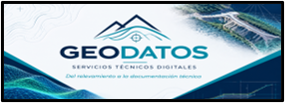

[index.html](https://github.com/user-attachments/files/33581227/index.html)
<!doctype html>
<html lang="es">
<head>
  <meta charset="utf-8">
  <meta name="viewport" content="width=device-width, initial-scale=1">
  <meta name="theme-color" content="#102b3f">
  <meta name="description" content="GEODATOS brinda servicios técnicos digitales de topografía, ingeniería, movimiento de suelos, procesamiento de drones y documentación de obra.">
  <title>GEODATOS | Servicios técnicos digitales</title>
  
</head>
<body>
<header>
  

    
    <nav aria-label="Navegación principal">
      <a href="#servicios">Servicios</a><a href="#nosotros">Cómo trabajamos</a><a href="#herramientas">Herramientas</a>
      <a class="nav-cta" href="#contacto">Solicitar presupuesto</a>
    </nav>
  

</header>

<main>
  <section class="hero" id="inicio">
    

      

        
Topografía · Ingeniería · Construcción

        <h1>De los datos de campo a decisiones más claras.</h1>
        
Procesamiento topográfico, movimiento de suelos, planos y documentación técnica para acompañar tus proyectos de ingeniería y construcción.

        

          <a class="btn btn-primary" href="#contacto">Hablemos de tu proyecto ↗</a>
          <a class="btn btn-outline" href="#servicios">Ver servicios</a>
        

        
Atención remotaEntregables digitalesSoporte técnico

      

      <aside class="hero-note">
        
01—06

        <h3>Soporte técnico para cada etapa</h3>
        
Desde el procesamiento de relevamientos y el control de obra hasta la documentación final conforme a obra.

      </aside>
    

  </section>

  <section class="services" id="servicios">
    

      

        
Qué hacemos

        <h2>Servicios técnicos digitales</h2>
        
Soluciones adaptadas al alcance, los datos disponibles y los requisitos de cada obra.

      

      

        <article class="service">
01
<h3>Procesamiento de datos topográficos</h3><ul><li>Organización y revisión de datos de campo.</li><li>Superficies de terreno natural y proyecto.</li><li>Modelos digitales, perfiles y secciones.</li><li>Preparación de archivos para replanteos y controles.</li></ul></article>
        <article class="service">
02
<h3>Movimiento de suelos y control de obra</h3><ul><li>Cálculo de volúmenes de corte y terraplén.</li><li>Comparación entre relevamientos y proyecto.</li><li>Análisis de cotas, pendientes y geometrías.</li><li>Reportes de cantidades para revisión técnica.</li></ul></article>
        <article class="service">
03
<h3>Protocolos y documentación de calidad</h3><ul><li>Revisión y control documental.</li><li>Planillas, registros y reportes de seguimiento.</li><li>Verificación de información topográfica.</li><li>Identificación de inconsistencias y faltantes.</li></ul></article>
        <article class="service">
04
<h3>Planos conforme a obra (As-Built)</h3><ul><li>Actualización de planos con datos verificados.</li><li>Registro de modificaciones ejecutadas.</li><li>Actualización de cotas, dimensiones y pendientes.</li><li>Organización de archivos finales para revisión.</li></ul></article>
        <article class="service">
05
<h3>Relevamientos con drones</h3><ul><li>Procesamiento fotogramétrico de datos UAV.</li><li>Superficies, modelos digitales y nubes de puntos.</li><li>Ortomosaicos y curvas de nivel según los datos.</li><li>Volúmenes y comparación de superficies.</li></ul></article>
        <article class="service">
06
<h3>Diseño y modificación de planos</h3><ul><li>Dibujo y edición de planos técnicos 2D.</li><li>Modelos de terreno y documentación 3D.</li><li>Perfiles, secciones y detalles constructivos.</li><li>Conversión y organización de archivos CAD.</li></ul></article>
      

    

  </section>

  <section id="nosotros">
    

      

        
GEODATOS

        <h2>Un soporte técnico que se integra a tu equipo.</h2>
        
Trabajamos junto a empresas constructoras, contratistas y profesionales para transformar información técnica en entregables claros, organizados y útiles para la planificación, ejecución y control de obra.

        
La modalidad remota permite sumar capacidad de procesamiento sin ampliar la estructura operativa del cliente.

      

      

        <h3>Cómo trabajamos</h3>
        <ul class="check-list">
          <li>Recepción de datos, planos y especificaciones.</li>
          <li>Revisión inicial y definición del alcance.</li>
          <li>Confirmación de formatos, plazos y entregables.</li>
          <li>Procesamiento, modelado, cálculo o documentación.</li>
          <li>Entrega digital y ajustes acordados.</li>
        </ul>
        
Cada trabajo se cotiza según su complejidad, volumen de información, nivel de detalle y plazo de entrega.

      

    

  </section>

  <section class="tools" id="herramientas">
    

      

        
Entorno de trabajo

        <h2>Herramientas digitales</h2>
        
Utilizamos software especializado de acuerdo con las necesidades y el alcance de cada proyecto.

      

      

        
<strong>Civil 3D</strong>Superficies, perfiles y volúmenes

        
<strong>AutoCAD</strong>Dibujo y documentación técnica

        
<strong>Pix4D</strong>Procesamiento fotogramétrico

        
<strong>Revit</strong>Modelado BIM según alcance

        
<strong>Formatos CAD</strong>DWG, DXF, PDF y compatibles

      

    

  </section>

  <section>
    

      

        
Proceso simple

        <h2>De la consulta a la entrega</h2>
      

      

        
<b>1. Nos contás el proyecto</b>
Indicá el tipo de trabajo, la ubicación general y qué archivos tenés disponibles.

        
<b>2. Definimos el alcance</b>
Revisamos la información y acordamos entregables, formato, plazo y presupuesto.

        
<b>3. Procesamos y entregamos</b>
Desarrollamos el trabajo y entregamos los archivos digitales acordados.

      

    

  </section>

  <section class="contact" id="contacto">
    

      

        
Contacto

        <h2>¿Tenés un proyecto para cotizar?</h2>
        
Contanos qué necesitás y qué información tenés disponible. Te responderemos para revisar el alcance y preparar una propuesta.

        
Antes de publicar el sitio, reemplazá los datos de contacto de ejemplo por los tuyos.

      

      

        <!-- WhatsApp GEODATOS: enlace en formato internacional, solo números. -->
        <a class="contact-link" href="https://wa.me/5493872118297" target="_blank" rel="noopener">↗ WhatsApp: +54 9 387 211-8297</a>
        <!-- Correo de contacto de GEODATOS. -->
        <a class="contact-link" href="mailto:geodatos.std@gmail.com?subject=Consulta%20de%20servicios%20GEODATOS">✉ geodatos.std@gmail.com</a>
        <a class="contact-link" href="mailto:geodatos.std@gmail.com?subject=Solicitud%20de%20presupuesto%20GEODATOS">＋ Solicitar presupuesto</a>
      

    

  </section>
</main>

<footer>
  

    <strong>GEODATOS</strong> — Servicios técnicos digitales
    Topografía · Ingeniería · Construcción
    © 2026 GEODATOS
  

</footer>
</body>
</html>
